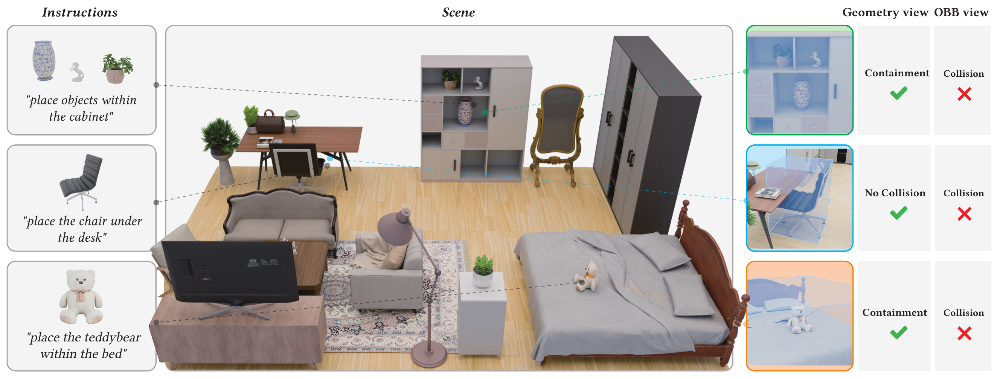
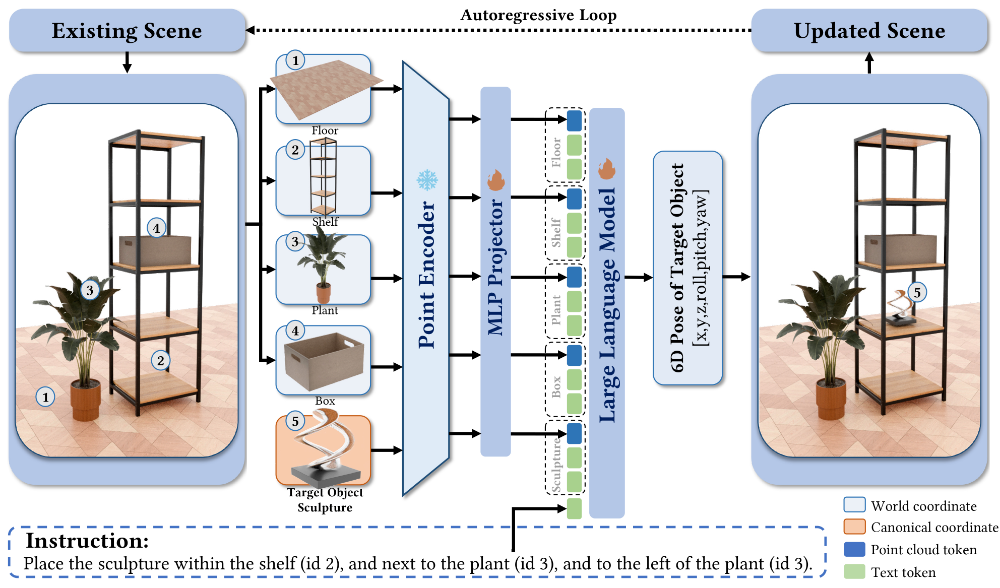

<div align="center">

# GALA: <u>G</u>eometry-<u>A</u>ware <u>L</u>anguage Model for Controllable Object <u>A</u>rrangement

### SIGGRAPH Asia 2026

[Chucheng Xiang](https://xccelephant.github.io)<sup>1,2</sup>,
[Runze Wang](https://rainzor.github.io/)<sup>1,2</sup>,
[Zhi Deng](https://orcid.org/0000-0003-4582-4874)<sup>2*</sup>,
[Ruchao Bao](https://orcid.org/0009-0002-4536-1953)<sup>1,2</sup>,
[Yuanwei Zhang](https://orcid.org/0009-0000-8388-5665)<sup>3,2</sup>,
[Yuxuan Xie](https://openreview.net/profile?id=~Yuxuan_Xie1)<sup>2</sup>,
[Hanliu Wang](https://orcid.org/0009-0001-4781-5077)<sup>2</sup>,<br>
[Liangzhen Fei](https://orcid.org/0009-0006-0919-9273)<sup>1,2</sup>,
[Wenzheng Wu](https://openreview.net/profile?id=~Wenzheng_Wu1)<sup>1,2</sup>,
[Cheng Wan](https://openreview.net/profile?id=~Cheng_Wan1)<sup>4,2</sup>,
[Peifeng Li](https://orcid.org/0009-0002-9847-6017)<sup>1,2</sup>,
[Zhongyuan Liu](https://digiartomnis.github.io/index.html)<sup>2</sup>,
[Ligang Liu](http://staff.ustc.edu.cn/~lgliu/)<sup>1*</sup>

<sup>1</sup>University of Science and Technology of China &nbsp;&nbsp;
<sup>2</sup>Tencent &nbsp;&nbsp;
<sup>3</sup>Tsinghua University &nbsp;&nbsp;
<sup>4</sup>Hong Kong University of Science and Technology

**[Project Page](https://xccelephant.github.io/paper/gala/)** |
**[arXiv](https://arxiv.org/abs/2610.28280)** |
**[Paper (DOI)](https://doi.org/10.1145/3829340.3842289)** |
**[HF Model](https://huggingface.co/ChuchengXiang/GALA-0.7B)** |
**[HF Dataset](https://huggingface.co/datasets/ChuchengXiang/GALA-Dataset)** |
**English** |
**[简体中文](README_zh.md)**

</div>

<p align="center">
  
</p>

## Overview

Reasoning about fine-grained placement constraints—such as physical support (`on`, `under`) and spatial containment (`within` open shelves or cabinets)—is essential for realistic 3D scene creation, yet remains out of reach for methods that rely solely on oriented bounding boxes (OBBs). **GALA** is a 0.7B geometry-aware multimodal language model ([Utonia](https://github.com/Pointcept/Utonia) point cloud encoder + [Qwen3-0.6B](https://github.com/QwenLM/Qwen3) LLM) that perceives explicit per-object point clouds alongside natural language instructions to autoregressively predict 6D object poses `[x, y, z, roll, pitch, yaw]`.

<p align="center">
  
</p>

### Key Features

- **Explicit Point Cloud Perception**: Encodes floor, existing-object, and target-object point clouds to resolve fine-grained containment and support geometry.
- **Two-Stage Training Recipe**: Stage 1 pretrains the multimodal MLP projector on 500k geometry–language alignment tasks; Stage 2 jointly fine-tunes the projector and LLM on 331k autoregressive placement steps.
- **Multi-Source 3DISH Dataset Pipeline**: End-to-end curation across 3D-FRONT, Imaginarium, SpatialLM, and artist-crafted scenes with scene-tree autoregressive ordering and physical filtering.
- **Plan–Place–Verify Scene Agent**: Couples LLM-driven scene planning, GALA placement inference, and Blender/XPBD physical verification for text-to-scene generation and interactive editing.

---

## Installation

### Hardware Requirements

- **Inference (GALA-0.7B)**: 1 GPU with >= 8 GB VRAM (~3 GB memory and ~1s per object placement).
- **Training (Two-Stage Full SFT)**: 8 GPUs with >= 80 GB VRAM (e.g., 8 × NVIDIA H20 / A100, ~7 hours total).

### 1. Python Environment

```bash
conda create -n gala python=3.11 -y
conda activate gala

# Install PyTorch (CUDA 12.1) and point cloud dependencies
uv pip install --python "$(which python)" \
    torch==2.5.1 torchvision==0.20.1 torchaudio==2.5.1 --index-url https://download.pytorch.org/whl/cu121
uv pip install --python "$(which python)" \
    torch_scatter==2.1.2 --find-links https://data.pyg.org/whl/torch-2.5.1+cu121.html
uv pip install --python "$(which python)" \
    https://github.com/Dao-AILab/flash-attention/releases/download/v2.7.4.post1/flash_attn-2.7.4.post1+cu12torch2.5cxx11abiFALSE-cp311-cp311-linux_x86_64.whl

# Install repository dependencies and customized LLaMA-Factory
uv pip install --python "$(which python)" -r requirements.txt
uv pip install --python "$(which python)" -e third_party/LLaMA-Factory

# Upgrade cuBLAS to prevent SIGFPE on Hopper GPUs (H20/H100) with torch cu121
uv pip install --python "$(which python)" "nvidia-cublas-cu12==12.3.4.1"
```

Verify installation:

```bash
python -c "from llamafactory.model.pointlm.inference import PointLMInference; print('OK')"
```

### 2. Blender & Convex Decomposition (for Agent Rendering & Physics Repair)

```bash
wget https://download.blender.org/release/Blender4.5/blender-4.5.0-linux-x64.tar.xz
tar -xf blender-4.5.0-linux-x64.tar.xz
export BLENDER_BIN="$(pwd)/blender-4.5.0-linux-x64/blender"

# Install vhacdx into Blender's bundled Python
"$(pwd)/blender-4.5.0-linux-x64/4.5/python/bin/python3.11" -m pip install vhacdx
```

---

## Checkpoints & Datasets

| Resource | Hugging Face Hub | Target Path | Description |
| :--- | :--- | :--- | :--- |
| **GALA-0.7B Checkpoint** | [`ChuchengXiang/GALA-0.7B`](https://huggingface.co/ChuchengXiang/GALA-0.7B) | `checkpoints/GALA-0.7B` | Paper-reported checkpoint (**Step 6240**) |
| **GALA-Dataset (3DISH)** | [`ChuchengXiang/GALA-Dataset`](https://huggingface.co/datasets/ChuchengXiang/GALA-Dataset) | `datasets/` | Processed splits, scenes, and Imaginarium assets |

```bash
# 1) Download the paper-reported GALA-0.7B checkpoint (Step 6240)
huggingface-cli download ChuchengXiang/GALA-0.7B --local-dir checkpoints/GALA-0.7B

# 2) Download the processed dataset and Imaginarium 3D assets
huggingface-cli download ChuchengXiang/GALA-Dataset --repo-type dataset --local-dir datasets_hf
mkdir -p datasets/Imaginarium datasets/processed
cp -r datasets_hf/processed/* datasets/processed/
tar -xzf datasets_hf/assets/imaginarium_assets.tar.gz -C datasets/Imaginarium

# Verify dataset directory configuration (or set export DATASETS_ROOT=/path/to/datasets)
python config/paths.py
```

---

## Quick Start: Scene Generation Agent

### 1. Configure LLM API

Copy the template and fill in an API key (OpenAI, Gemini, Anthropic, or a local OpenAI-compatible endpoint) for high-level scene planning:

```bash
cp config/llm_key_example.json config/llm_key.json
```

### 2. Build Asset Index (First Run Only)

```bash
python scripts/run_agent.py build-index --dataset imaginarium
```

### 3. Generate, Edit & Visualize Scenes

**Generate a scene from text:**

```bash
python scripts/run_agent.py generate \
    -m "$(pwd)/checkpoints/<model_dir>" \
    -i "I want a modern bedroom with a double bed, two nightstands, and a wardrobe." \
    -b "[[0,0],[4,0],[4,3.5],[0,3.5]]"
```

**Incrementally edit an existing scene:**

```bash
python scripts/run_agent.py edit \
    -m "$(pwd)/checkpoints/<model_dir>" \
    -s output/agent/generated_scene/generated_scene_layout.json \
    -i "Add a floor lamp to the right of the bed."
```

**Batch generation across multiple GPUs:**

```bash
python scripts/run_agent.py batch \
    -m "$(pwd)/checkpoints/<model_dir>" \
    --jobs scenes.json \
    --gpus "0,1,2,3"
```

**Render or inspect in Blender:**

```bash
blender -b -P scripts/visualize_layout.py -- \
    --layout output/agent/generated_scene/generated_scene_layout_repaired.json \
    --render-image output/visualizations/generated_scene.png \
    --dataset auto
```

Outputs are saved under `output/agent/<scene_id>/`, including `<scene_id>_layout.json`, `<scene_id>_layout.glb`, physics-repaired `<scene_id>_layout_repaired.{json,glb}`, and step-by-step renders.

---

## Dataset Construction, Training & Evaluation

### 1. Dataset Pipeline (3DISH)

To rebuild the training, validation, and test splits from raw multi-source scene collections (3D-FRONT, Imaginarium, SpatialLM, and artist-crafted scenes):

```bash
# Run all 17 stages: asset point cloud sampling, scene conversion, rotation augmentation,
# physical filtering, scene-tree autoregressive sequence generation, and 9:0.5:0.5 family splitting
bash scripts/run_data_pipeline.sh --dataset 3dish --tag ""

# Pre-cache Utonia grid-subsampled point cloud features (.utonia.npy) for fast training
cd third_party/LLaMA-Factory
python scripts/pointlm_cache_pcd.py \
    --data_files ../../datasets/processed/ \
    --backbone_type utonia \
    --utonia_grid_size 0.02 \
    --workers 64
```

### 2. Two-Stage Training

All training configurations reside in `third_party/LLaMA-Factory/`:

```bash
cd third_party/LLaMA-Factory

# 0) Assemble initial Utonia + Qwen3-0.6B checkpoint
python scripts/transfer_point_encoder.py \
    --point_encoder_source /path/to/utonia.pth \
    --llm_backbone Qwen/Qwen3-0.6B \
    --output models/Utonia-Qwen3-0.6B

# 1) Stage 1: Projector Alignment Pretraining (freeze Utonia & Qwen3, train projector for 3 epochs)
CUDA_VISIBLE_DEVICES=0,1,2,3,4,5,6,7 llamafactory-cli train \
    examples/train_full/qwen3-0_6b/3dish_alignment_500k_train/base.yaml

# 2) Stage 2: Autoregressive Placement Fine-Tuning (freeze Utonia, train projector + LLM for 4 epochs)
CUDA_VISIBLE_DEVICES=0,1,2,3,4,5,6,7 llamafactory-cli train \
    examples/train_full/qwen3-0_6b/3dish_separate_pointcloud_331k_train/base.yaml
```

Or run the automated training and evaluation sequence script:

```bash
cd third_party/LLaMA-Factory
CUDA_VISIBLE_DEVICES=0,1,2,3,4,5,6,7 bash scripts/run_train_sequence.sh
```

**Ablation Study Configs (`examples/train_full/qwen3-0_6b/`)**:
- **w/o point cloud (text-only SFT)**: `3dish_331k_train/base.yaml`
- **w/o pretraining (skip Stage 1)**: `3dish_separate_pointcloud_331k_train/without_pretrain.yaml`
- **w/o artist scenes (exclude Imaginarium & handcrafted)**: `3dish_no_imaginarium_handcrafted_separate_pointcloud_train/base.yaml`

### 3. Evaluation

**Single-object placement benchmark (`Within Valid Rate`, `Instruction Valid Rate`, `Floating Rate`, `Support Ratio`):**

```bash
cd third_party/LLaMA-Factory

# Evaluate all checkpoints in a training directory and generate leaderboard.csv
CUDA_VISIBLE_DEVICES=0,1,2,3,4,5,6,7 \
NUM_GPUS=8 \
EXPERIMENT=qwen3-0_6b/3dish_separate_pointcloud_331k_train \
TRAIN_YAML=examples/train_full/qwen3-0_6b/3dish_separate_pointcloud_331k_train/base.yaml \
DATA_FILE=../../datasets/processed/3dish_separate_pointcloud_331k_test.json \
SCORE_DATA_FILE=../../datasets/processed/3dish_separate_pointcloud_331k_test.json \
bash scripts/run_pointlm_eval.sh
```

**Whole-scene autoregressive rollout on held-out test scenes:**

```bash
SCENE_ID="imaginarium_bedroom_14" \
PCD_MODEL_PATH="/path/to/checkpoint" \
bash scripts/run_ar_infer.sh
```

---

## Citation

If you find GALA, our codebase, or the 3DISH dataset helpful in your research, please cite our SIGGRAPH Asia 2026 paper:

```bibtex
@inproceedings{xiang2026gala,
  title     = {{GALA}: Geometry-Aware Language Model for Controllable Object Arrangement},
  author    = {Xiang, Chucheng and Wang, Runze and Deng, Zhi and Bao, Ruchao and Zhang, Yuanwei and Xie, Yuxuan and Wang, Hanliu and Fei, Liangzhen and Wu, Wenzheng and Wan, Cheng and Li, Peifeng and Liu, Zhongyuan and Liu, Ligang},
  booktitle = {Proceedings of the SIGGRAPH Asia 2026 Conference Papers},
  year      = {2026},
  publisher = {ACM},
  doi       = {10.1145/3829340.3842289}
}
```

## Acknowledgements & License

We thank the authors of [LLaMA-Factory](https://github.com/hiyouga/LLaMA-Factory), [Utonia](https://github.com/Pointcept/Utonia), [Qwen3](https://github.com/QwenLM/Qwen3), [Imaginarium](https://huggingface.co/datasets/HiHiAllen/Imaginarium-Dataset), [3D-FRONT](https://tianchi.aliyun.com/specials/promotion/alibaba-3d-scene-dataset), [ReSpace](https://github.com/gradient-spaces/respace), and [SpatialLM](https://github.com/manycore-research/SpatialLM) for their open-source contributions.

- **Code**: Licensed under the [Apache License 2.0](LICENSE) (see [NOTICE](NOTICE)).
- **Dataset**: Released under the [CC BY 4.0](https://creativecommons.org/licenses/by/4.0/) license.
