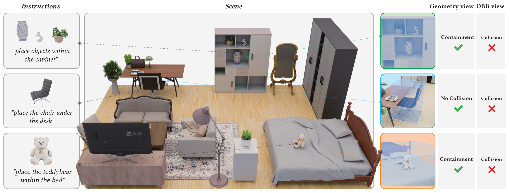
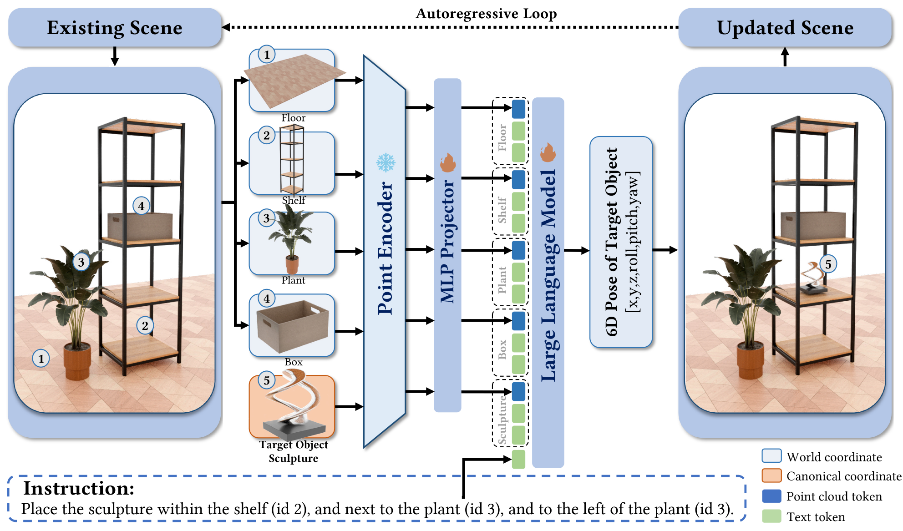

<div align="center">

# GALA: <u>G</u>eometry-<u>A</u>ware <u>L</u>anguage Model for Controllable Object <u>A</u>rrangement

### SIGGRAPH Asia 2026

[Chucheng Xiang](https://xccelephant.github.io)<sup>1,2</sup>,
[Runze Wang](https://rainzor.github.io/)<sup>1,2</sup>,
[Zhi Deng](https://orcid.org/0000-0003-4582-4874)<sup>2*</sup>,
[Ruchao Bao](https://orcid.org/0009-0002-4536-1953)<sup>1,2</sup>,
[Yuanwei Zhang](https://orcid.org/0009-0000-8388-5665)<sup>3,2</sup>,
[Yuxuan Xie](https://openreview.net/profile?id=~Yuxuan_Xie1)<sup>2</sup>,
[Hanliu Wang](https://orcid.org/0009-0001-4781-5077)<sup>2</sup>,<br>
[Liangzhen Fei](https://orcid.org/0009-0006-0919-9273)<sup>1,2</sup>,
[Wenzheng Wu](https://openreview.net/profile?id=~Wenzheng_Wu1)<sup>1,2</sup>,
[Cheng Wan](https://openreview.net/profile?id=~Cheng_Wan1)<sup>4,2</sup>,
[Peifeng Li](https://orcid.org/0009-0002-9847-6017)<sup>1,2</sup>,
[Zhongyuan Liu](https://digiartomnis.github.io/index.html)<sup>2</sup>,
[Ligang Liu](http://staff.ustc.edu.cn/~lgliu/)<sup>1*</sup>

<sup>1</sup>中国科学技术大学 &nbsp;&nbsp;
<sup>2</sup>腾讯 &nbsp;&nbsp;
<sup>3</sup>清华大学 &nbsp;&nbsp;
<sup>4</sup>香港科技大学

**[项目主页 (Project Page)](https://xccelephant.github.io/paper/gala/)** |
**[arXiv](https://arxiv.org/abs/2610.28280)** |
**[论文 (DOI)](https://doi.org/10.1145/3829340.3842289)** |
**[HF 模型 (Model)](https://huggingface.co/ChuchengXiang/GALA-0.7B)** |
**[HF 数据集 (Dataset)](https://huggingface.co/datasets/ChuchengXiang/GALA-Dataset)** |
**[English](README.md)** |
**简体中文**

</div>

<p align="center">
  
</p>

## 简介 (Overview)

在 3D 室内场景构建中，处理精细的物体摆放约束——例如物理支撑（`on`、`under`）与空间包含（如将物体放入开放式书架或柜体隔层内的 `within` 约束）——至关重要。然而，仅依赖定向包围盒（OBB）的现有方法无法感知物体局部几何细节。为此，我们提出 **GALA**：一个 0.7B 参数量的几何感知多模态语言模型（基于 [Utonia](https://github.com/Pointcept/Utonia) 点云编码器与 [Qwen3-0.6B](https://github.com/QwenLM/Qwen3) 语言模型），通过联合编码地板、场景已有物体与目标物体的显式点云及自然语言指令，自回归地逐步预测目标物体的 6D 位姿 `[x, y, z, roll, pitch, yaw]`。

<p align="center">
  
</p>

### 核心特性

- **显式点云几何感知**：联合编码地面点云、已有物体点云与待摆放物体点云，精准建模柜内收纳（`within`）与表面支撑（`on`）等细粒度几何约束。
- **两阶段训练范式**：Stage 1 在 50 万条几何–语言对齐任务上预训练 MLP Projector；Stage 2 在 33.1 万条自回归摆放样本上联合微调 Projector 与 LLM。
- **多源 3DISH 数据集流水线**：融合 3D-FRONT、Imaginarium、SpatialLM 与艺术家精标场景（`handcrafted`），提供从物理过滤、场景树自回归序列构建到场景家族分层划分的完整流水线。
- **Plan–Place–Verify 场景生成 Agent**：结合零样本 LLM 场景规划、GALA 逐步位姿预测与 Blender/XPBD 物理校验修复，支持从单句文本生成完整 3D 场景及交互式局部编辑。

---

## 环境安装 (Installation)

### 算力需求

- **推理 (GALA-0.7B)**：单张 >= 8 GB 显存的消费级 GPU 即可运行（单步显存约 3 GB，耗时约 1s）。
- **训练 (两阶段全量微调)**：建议使用 8 张 >= 80 GB 显存 GPU（如 8 × NVIDIA H20 / A100，完整两阶段训练约 7 小时）。

### 1. 安装 Python 环境

```bash
conda create -n gala python=3.11 -y
conda activate gala

# 安装 PyTorch (CUDA 12.1) 与点云算子依赖
uv pip install --python "$(which python)" \
    torch==2.5.1 torchvision==0.20.1 torchaudio==2.5.1 --index-url https://download.pytorch.org/whl/cu121
uv pip install --python "$(which python)" \
    torch_scatter==2.1.2 --find-links https://data.pyg.org/whl/torch-2.5.1+cu121.html
uv pip install --python "$(which python)" \
    https://github.com/Dao-AILab/flash-attention/releases/download/v2.7.4.post1/flash_attn-2.7.4.post1+cu12torch2.5cxx11abiFALSE-cp311-cp311-linux_x86_64.whl

# 安装项目依赖与内置定制版 LLaMA-Factory
uv pip install --python "$(which python)" -r requirements.txt
uv pip install --python "$(which python)" -e third_party/LLaMA-Factory

# 升级 cuBLAS，避免 Hopper 架构 (H20/H100) 下 torch cu121 触发 SIGFPE
uv pip install --python "$(which python)" "nvidia-cublas-cu12==12.3.4.1"
```

验证安装：

```bash
python -c "from llamafactory.model.pointlm.inference import PointLMInference; print('OK')"
```

### 2. 安装 Blender 与凸分解依赖（用于物理修正与渲染）

```bash
wget https://download.blender.org/release/Blender4.5/blender-4.5.0-linux-x64.tar.xz
tar -xf blender-4.5.0-linux-x64.tar.xz
export BLENDER_BIN="$(pwd)/blender-4.5.0-linux-x64/blender"

# 将 vhacdx 安装到 Blender 自带的 Python 解释器中
"$(pwd)/blender-4.5.0-linux-x64/4.5/python/bin/python3.11" -m pip install vhacdx
```

---

## 模型权重与数据集下载

| 内容 | Hugging Face 仓库 | 放置路径 | 说明 |
| :--- | :--- | :--- | :--- |
| **GALA-0.7B 模型权重** | [`ChuchengXiang/GALA-0.7B`](https://huggingface.co/ChuchengXiang/GALA-0.7B) | `checkpoints/GALA-0.7B` | 论文汇报主模型权重（**Step 6240**） |
| **GALA-Dataset (3DISH)** | [`ChuchengXiang/GALA-Dataset`](https://huggingface.co/datasets/ChuchengXiang/GALA-Dataset) | `datasets/` | 处理后的训练/测试划分、四源场景及 Imaginarium 资产库 |

```bash
# 1) 下载论文汇报的 GALA-0.7B 模型权重 (Step 6240)
huggingface-cli download ChuchengXiang/GALA-0.7B --local-dir checkpoints/GALA-0.7B

# 2) 下载处理后的数据集与 Imaginarium 3D 资产库
huggingface-cli download ChuchengXiang/GALA-Dataset --repo-type dataset --local-dir datasets_hf
mkdir -p datasets/Imaginarium datasets/processed
cp -r datasets_hf/processed/* datasets/processed/
tar -xzf datasets_hf/assets/imaginarium_assets.tar.gz -C datasets/Imaginarium

# 检查数据集路径配置（可通过 export DATASETS_ROOT=/path/to/datasets 自定义外部存储路径）
python config/paths.py
```

---

## 快速开始：场景生成 Agent

### 1. 配置规划器 LLM API

复制示例配置并在 `providers` 中填入任意云端 API Key（支持 OpenAI / Gemini / Anthropic 或本地兼容接口）：

```bash
cp config/llm_key_example.json config/llm_key.json
```

### 2. 构建资产索引（首次运行必选）

```bash
python scripts/run_agent.py build-index --dataset imaginarium
```

### 3. 生成、编辑与可视化场景

**单场景文本生成：**

```bash
python scripts/run_agent.py generate \
    -m "$(pwd)/checkpoints/<model_dir>" \
    -i "I want a modern bedroom with a double bed, two nightstands, and a wardrobe." \
    -b "[[0,0],[4,0],[4,3.5],[0,3.5]]"
```

**在已有场景上用自然语言增量编辑：**

```bash
python scripts/run_agent.py edit \
    -m "$(pwd)/checkpoints/<model_dir>" \
    -s output/agent/generated_scene/generated_scene_layout.json \
    -i "在床的右侧再放一个落地灯"
```

**多 GPU 批量并发生成：**

```bash
python scripts/run_agent.py batch \
    -m "$(pwd)/checkpoints/<model_dir>" \
    --jobs scenes.json \
    --gpus "0,1,2,3"
```

**使用 Blender 渲染可视化：**

```bash
blender -b -P scripts/visualize_layout.py -- \
    --layout output/agent/generated_scene/generated_scene_layout_repaired.json \
    --render-image output/visualizations/generated_scene.png \
    --dataset auto
```

产物默认保存在 `output/agent/<scene_id>/`，包含布局 `<scene_id>_layout.json`、带材质贴图的 `<scene_id>_layout.glb`、物理修正后的 `<scene_id>_layout_repaired.{json,glb}` 以及分步渲染图。

---

## 数据集构建、两阶段训练与论文评测复现

### 1. 数据集预处理与构建 (3DISH)

若需从原始多源场景（3D-FRONT、Imaginarium、SpatialLM、手工精标场景 `handcrafted`）完整构建训练/验证/测试集及消融子集：

```bash
# 运行全部 17 个步骤：资产点云采样、场景转换、旋转增强、物理过滤、
# 场景树自回归序列生成、分离点云与对齐样本构建、按场景家族 9:0.5:0.5 划分
bash scripts/run_data_pipeline.sh --dataset 3dish --tag ""

# 预缓存 Utonia 0.02m 网格下采样特征 (.utonia.npy) 以加速多模态训练
cd third_party/LLaMA-Factory
python scripts/pointlm_cache_pcd.py \
    --data_files ../../datasets/processed/ \
    --backbone_type utonia \
    --utonia_grid_size 0.02 \
    --workers 64
```

### 2. 两阶段模型训练

训练配置位于 `third_party/LLaMA-Factory/`：

```bash
cd third_party/LLaMA-Factory

# 0) 组装 Utonia + Qwen3-0.6B 初始多模态底座
python scripts/transfer_point_encoder.py \
    --point_encoder_source /path/to/utonia.pth \
    --llm_backbone Qwen/Qwen3-0.6B \
    --output models/Utonia-Qwen3-0.6B

# 1) Stage 1：几何–语言 Projector 对齐预训练 (冻结 Utonia 与 Qwen3，仅训练 MLP Projector，3 epochs)
CUDA_VISIBLE_DEVICES=0,1,2,3,4,5,6,7 llamafactory-cli train \
    examples/train_full/qwen3-0_6b/3dish_alignment_500k_train/base.yaml

# 2) Stage 2：自回归摆放微调 (冻结 Utonia，联合微调 Projector + Qwen3 LLM，4 epochs)
CUDA_VISIBLE_DEVICES=0,1,2,3,4,5,6,7 llamafactory-cli train \
    examples/train_full/qwen3-0_6b/3dish_separate_pointcloud_331k_train/base.yaml
```

也可直接调用一键训练与评估脚本（传入 `RUN_ABLATIONS=true` 可同步运行全部消融实验）：

```bash
cd third_party/LLaMA-Factory
CUDA_VISIBLE_DEVICES=0,1,2,3,4,5,6,7 bash scripts/run_train_sequence.sh
```

**论文消融实验配置 (`examples/train_full/qwen3-0_6b/`)**：
- **w/o point cloud（纯文本微调）**：`3dish_331k_train/base.yaml`
- **w/o pretraining（跳过 Stage 1 直接微调）**：`3dish_separate_pointcloud_331k_train/without_pretrain.yaml`
- **w/o artist scenes（移除高质量场景子集）**：`3dish_no_imaginarium_handcrafted_separate_pointcloud_train/base.yaml`

### 3. 论文评测指标复现

**单步物体摆放评测 (`Within Valid Rate` / `Instruction Valid Rate` / `Floating Rate` / `Support Ratio`)：**

```bash
cd third_party/LLaMA-Factory

# 自动遍历训练目录下的 checkpoints 并汇总 leaderboard.csv
CUDA_VISIBLE_DEVICES=0,1,2,3,4,5,6,7 \
NUM_GPUS=8 \
EXPERIMENT=qwen3-0_6b/3dish_separate_pointcloud_331k_train \
TRAIN_YAML=examples/train_full/qwen3-0_6b/3dish_separate_pointcloud_331k_train/base.yaml \
DATA_FILE=../../datasets/processed/3dish_separate_pointcloud_331k_test.json \
SCORE_DATA_FILE=../../datasets/processed/3dish_separate_pointcloud_331k_test.json \
bash scripts/run_pointlm_eval.sh
```

**测试集整屋自回归推理 (Whole-Scene Autoregressive Rollout)：**

```bash
SCENE_ID="imaginarium_bedroom_14" \
PCD_MODEL_PATH="/path/to/checkpoint" \
bash scripts/run_ar_infer.sh
```

---

## 引用 (Citation)

如果本项目代码、模型或数据集对您的研究有所帮助，请引用我们的 SIGGRAPH Asia 2026 论文：

```bibtex
@inproceedings{xiang2026gala,
  title     = {{GALA}: Geometry-Aware Language Model for Controllable Object Arrangement},
  author    = {Xiang, Chucheng and Wang, Runze and Deng, Zhi and Bao, Ruchao and Zhang, Yuanwei and Xie, Yuxuan and Wang, Hanliu and Fei, Liangzhen and Wu, Wenzheng and Wan, Cheng and Li, Peifeng and Liu, Zhongyuan and Liu, Ligang},
  booktitle = {Proceedings of the SIGGRAPH Asia 2026 Conference Papers},
  year      = {2026},
  publisher = {ACM},
  doi       = {10.1145/3829340.3842289}
}
```

## 致谢与开源协议 (Acknowledgements & License)

感谢 [LLaMA-Factory](https://github.com/hiyouga/LLaMA-Factory)、[Utonia](https://github.com/Pointcept/Utonia)、[Qwen3](https://github.com/QwenLM/Qwen3)、[Imaginarium](https://huggingface.co/datasets/HiHiAllen/Imaginarium-Dataset)、[3D-FRONT](https://tianchi.aliyun.com/specials/promotion/alibaba-3d-scene-dataset)、[ReSpace](https://github.com/gradient-spaces/respace) 与 [SpatialLM](https://github.com/manycore-research/SpatialLM) 等开源项目与数据集的贡献。

- **代码协议 (Code)**：基于 [Apache License 2.0](LICENSE) 开源（详见 [NOTICE](NOTICE)）。
- **数据集协议 (Dataset)**：基于 [CC BY 4.0](https://creativecommons.org/licenses/by/4.0/) 协议发布。
